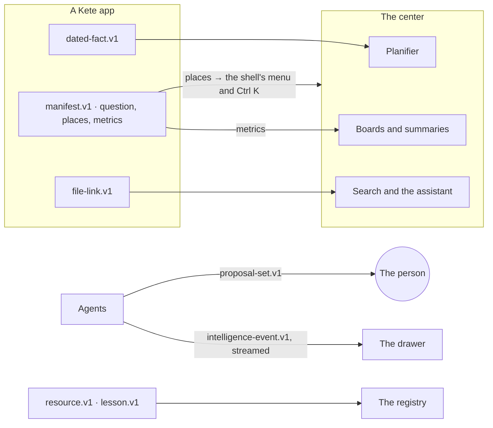

# Spec 099 — The contracts of the canvas

Step **L1** of phase 9 (`docs/ROADMAP.md`; doctrine D-050 to D-054): the shared language the
center, the apps, WhatsApp and the screens speak before any module of the canvas is built.

## Why

The canvas the author validated (version 3.1) rests on things that cross services: the center's
Planifier shows what every app says will happen; boards compose figures every app declares; the
evening's tidying proposes gestures in several apps; a skill, an agent and an app share one
lifecycle; the assistant's turn is shown the same way in the center and in every app. Without
contracts, each would invent its own shape, and the center could not compose them.

## Requirements

- **FR-001 — The manifest says the app's canvas** (additive in v1): its question (shown on its
  home), its places in the order of its sidebar (words for people in French and English, a path,
  a section, an icon, the permission that shows it), and its metrics.
- **FR-002 — A dated fact** (`dated-fact.v1`): a meeting, a deadline, an absence, a task, a
  milestone or an agent's run, on a whole day (with an optional last day) or at a moment — never
  both, never neither — with its people, project, third party, visibility (shared, busy, private;
  an absence never says why) and a link. Said again under its key, it replaces itself; cancelled,
  it is taken back.
- **FR-003 — A metric** (`metric.v1`): a name of the app's area and figure, its words, how it is
  computed, its unit, whether a rise is good news, and its axes — the center's references.
- **FR-004 — A proposal set** (`proposal-set.v1`): several gestures proposed together (postpone,
  close, block, assign, correct, remind, lesson, create), each with its words, its reason, the
  level of the gesture that applies it and whether it starts ticked.
- **FR-005 — A resource and its lessons** (`resource.v1`, `lesson.v1`): a skill, an agent or an app
  with its owner, version, tier (me, team, unit, organization), the review asked by its risk, and
  its test cases; a lesson from a correction, a note or an agent, which travels only with consent
  and is kept or dropped by the owner.
- **FR-006 — A file link** (`file-link.v1`): a file an app keeps, the object it proves, its role,
  nature, origin, project, third party and until when it is kept.
- **FR-007 — The stream of a Kete Intelligence turn** (`intelligence-event.v1`): status, plan, step,
  tool (with its level), draft, source, text, waiting, done and failed.
- **FR-008 — `@kete/sdk` validates each** and exports its type.

## Proof

- `packages/sdk/tests/canvas-contracts.test.ts` (6): a dated fact on a day or at a moment, refused
  with neither or both, taken back; a manifest with its question, places and metrics, refused with
  a place without words or a path; a proposal set refused empty or with a level beyond 4; a resource
  through its tiers and a lesson refused without consent; a file link; a whole turn of Kete
  Intelligence event by event, an unknown event refused.
- The other contract tests pass unchanged (34 in the package).

## What stays for later

Each module built on these contracts (L2 to L8) brings its own proof; nothing reads them yet.
