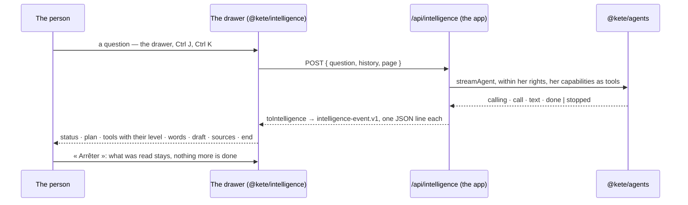

# Spec 101 — Kete Intelligence

Step **L3** of phase 9 (`docs/ROADMAP.md`; doctrine D-045, D-051): the assistant beside every page,
the same in the center and in every app, showing what it does as it does it.

## Why

Each app had a page « Demander »: a question, a wait, an answer in one block — the author found it
too classic. Kete Enterprise had a rich chat of its own that no app could reuse. A person must see
what the assistant is doing now, its plan, each capability it calls and how far it may go alone,
the answer as it is written, a draft to verify in place, its sources — and be able to stop it.

## Requirements

- **FR-001 — The runtime says each capability as it starts** (`@kete/agents`: the event `calling`),
  before what became of it (`call`).
- **FR-002 — The server half** (`@kete/intelligence/server`): `toIntelligence` tells a turn as the
  contract — each capability running then done or failed, with its autonomy level; a draft with
  where it is verified; a source the product can open; the words; the end with how many
  capabilities and how long; `waiting` when a gesture needs her confirmation; `failed` with a code.
  `intelligenceResponse` streams it, the whole turn within the person's context (`within`);
  `refused` says a turn that cannot start. No word on the server.
- **FR-003 — The screen half** (`@kete/intelligence`): `readEvents` reads the stream line by line;
  `reduceTurn` rebuilds the turn; `useIntelligence` asks one question at a time and stops it;
  `IntelligencePanel` draws the page she asks from, the conversation, the status (what it reads now),
  the plan checked as it goes, each capability with its level, the words, the drafts with
  « Vérifier », the sources, the end, a reason in words, the suggestions, and the field with
  « Arrêter ».
- **FR-004 — The contract accepts a product's own addresses** (`uri-reference` for a draft's and a
  source's `href`).
- **FR-005 — The template has no page « Demander » any more**: its frame opens the drawer (the button,
  Ctrl J, Ctrl K's question); `/api/intelligence` streams the turn with her readings only, the page
  she asks from given to the model.

## Proof

- `packages/intelligence/tests/intelligence.test.tsx` (7): a turn told as the contract, every event
  valid, each capability with its level, the draft, the source, the end with its length; a gesture
  waiting for her, a failure as a code, a turn that cannot start; one JSON line per event read back;
  a turn rebuilt from its events; the drawer showing what it reads now, the level and « Arrêter »;
  the draft, the sources, the end and a failure in words; the suggestions.
- `packages/agents/tests/runtime.test.ts`: the stream says a call as it starts.
- `templates/app/tests/complete.test.ts`: without a model, the stream says « not connected »; with
  one, each reading as it starts and ends with level 1, the words, then the end — within her rights.
- In the design preview (« cadre »): the drawer plays a turn from a real stream — the plan checked,
  three capabilities with their levels, the words, the draft with « Vérifier », the source, « 3
  gestes · 5 s » — and « Arrêter » stops one.

## What stays for later

Kete Enterprise's own chat on this package (step C1), files dropped in the drawer, dictation, the
conversation kept across pages, a plan announced by the model itself.
