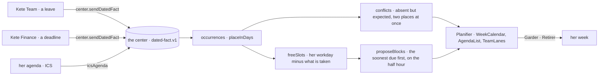

# Spec 102 — The time of the organization

Step **L4** of phase 9 (`docs/ROADMAP.md`; doctrine D-050, D-051): every app says what will happen at
a time, and code — never the model — says when each happens, what clashes, what time a person has
free, and where her tasks could go. The center's Planifier shows it; the assistant explains and
proposes what the code found.

## Why

The canvas's week (the v3 mockup): Kossi is away Thursday and Friday, and the reception of the
material on Friday is his. Nobody sees it until Friday morning: the leave lives in Kete Team, the
reception in a project, Afi's bank meeting in her own agenda. A model asked « organise ma semaine »
would guess dates; a person needs the clash found, the free hours counted, and blocks proposed she
keeps or removes.

## Requirements

- **FR-001 — When a fact happens** (`@kete/time`): `occurrences` reads dated facts in the
  organization's day (its offset from UTC): a whole day or a span of days, a moment, an instant; a
  fact taken back is gone. `placeInDays` lays them on the days of a range, as a calendar draws them —
  a span on each of its days, a moment past midnight cut at it.
- **FR-002 — What clashes**: `conflicts` finds a person expected while she is away and a person in
  two places at once, in time order.
- **FR-003 — Free time and blocks**: `freeSlots` gives a person's free time within her workday, minus
  her meetings, tasks and absences and the past; `proposeBlocks` places tasks in it, the soonest due
  first, each whole, starting on the half hour, never past its due day — a task that fits nowhere is
  left out for the caller to say.
- **FR-004 — Her own agenda**: the port `AgendaSource` and its first adapter `icsAgenda` (every
  agenda exports ICS): folded lines, UTC and local times, whole days, cancelled events skipped; read
  in as « busy » facts — others see that she is taken, not what she does.
- **FR-005 — An app says its time to the center** (`@kete/center`): `sendDatedFact` in the
  contract's shape (`/v1/time/facts`), said again under its key it replaces itself;
  `dropDatedFact` takes it back; without a center, `not_connected`.
- **FR-006 — The calendar's parts** (`@kete/design`): `WeekCalendar` (the whole days on top, the
  hours, meetings, tasks, agents' runs, a proposal dashed with its gestures when there is room, a
  clash marked, now), the same week as `AgendaList` below 760 px, and `TeamLanes` (people by unit,
  day by day; an absence hatched, never its reason; « busy » only). Every word through props.

## Proof

- `packages/time/tests/time.test.ts` (7): the week in the contract, a span as days, a fact taken
  back gone, the day of an organization one hour ahead; the week laid on its days, a night shift cut
  at midnight; Kossi expected while away and Afi in two meetings at once — given to Yao, no clash;
  Afi's free time, Kossi's leave without any; blocks the soonest due first, never past their day, on
  the half hour; an ICS feed read, its events brought in as « busy » facts valid in the contract, and
  her bank meeting clashing with what Kete knows.
- `packages/center/tests/time.test.ts` (3): a leave and a reception sent in the contract's shape and
  valid against it, one taken back; a day and a moment together refused by the contract; alone,
  `not_connected` and `signed_out`.
- `packages/design/tests/calendar.test.tsx` (3): the week with today, a proposal and its gesture, a
  clash, now, a time said and not only drawn; the list day by day, empty days left out; the lanes
  with an absence and no reason.
- In the design preview (« planifier »): the canvas's week computed by `@kete/time` — the clash on
  Friday, « Confier à Yao » clears it, two blocks proposed on Tuesday at 11 h and 11 h 30 — in both
  modes, as a list on a phone, and the team's lanes.

## What stays for later

The center's own store and its Planifier page (Kete Enterprise, step C12 `079-plan`); an agenda's
two-way sync (writing a kept block back to her agenda); recurrence rules (`RRULE`) in ICS feeds;
time zones other than the organization's.
