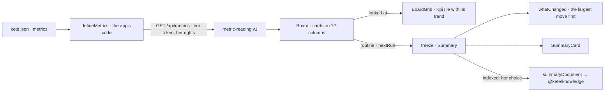

# Spec 103 — Figures and boards

Step **L5** of phase 9 (`docs/ROADMAP.md`; doctrine D-052): an app declares its figures and computes
them within the reader's rights; a board composes them — looked at live, sent by a routine, frozen
as a summary and indexed only when she chose so. One object, not three.

## Why

Kete Enterprise's dashboards (specs 033, 050) read the center's own sources with small queries; an
app's home showed figures of its own; routines (051) and notes (055) lived apart. A person wants
« Mon tableau »: the money available from Kete Finance, the absences from Kete Team, the deadlines
from Kete Commitments, side by side, compared with the period before, sent at 7 h with what
changed since yesterday — and kept, so that last Tuesday's board is still what it said then.

## Requirements

- **FR-001 — A reading travels as a contract** (`metric-reading.v1`): the figure's value — null when
  there is nothing to count or she may not read it (`denied`) — the value of the period before, its
  currency, its days, the filters it applied, when it was read.
- **FR-002 — An app's figures** (`@kete/metrics/server`): `defineMetrics` refuses at start a figure
  that breaks `metric.v1`, has no currency in money, or is declared twice; `read` computes each for
  the reader — a period ending today (7, 30, 90 days, the quarter or year so far, everything) and,
  when she compares, the same number of days before; a figure without the `period` axis is a state,
  never dated; a filter applies only on the figure's axes; `MetricDenied` gives a denied reading.
  `metricsResponse` serves them at `/api/metrics` within her context; `readMetrics` reads another
  app's with her token, dropping what breaks the contract.
- **FR-003 — For screens** (`@kete/metrics`): periods and `trend`, toned by the figure's `better` —
  more absences is bad news — and nothing that runs only on a server.
- **FR-004 — A board** (`@kete/boards`): cards naming apps' figures or carrying her note, each in a
  place on twelve columns that `arrange` keeps (inside, none over another, none floating); a phone
  reads them in the same order; a new card goes under the others; a routine runs every day, working
  day, week or month at a time of the organization's day (`nextRun`).
- **FR-005 — A summary**: `freeze` keeps each figure as its app said it — its trend, whether it
  reached its goal, passed its threshold, could not be read or got no answer — her notes and her
  words; a card the assistant proposed is not hers yet and is left out. `whatChanged` says what
  moved since the last one, the largest move first; `summaryDocument` makes it a document for
  `indexDocument` when she chose to index the board.
- **FR-006 — The parts** (`@kete/design`): `KpiTile` with its `trend`; `BoardGrid` (twelve columns,
  one on a phone, a proposal dashed with her gestures); `SummaryCard` (what changed, each figure,
  her words, its gestures). Every word through props.
- **FR-007 — A generated app is born with its figures**: the template declares `tasks.open` and
  `tasks.overdue` in `kete.json`, serves them at `/api/metrics` within the reader's rights, and its
  manifest carries its question, places and metrics.

## Proof

- `packages/metrics/tests/metrics.test.ts` (6): periods and the one before; readings compared, a
  state never dated, a figure she may not read; filters on the axes only; figures refused at start;
  `/api/metrics` answered within her context and read back by another app; an app that does not
  answer, a reading that breaks the contract.
- `packages/boards/tests/boards.test.ts` (5): places that hold and the phone's order; routines on
  working days, weekly, monthly, in an organization one hour ahead; a summary with trends, goal,
  threshold, a missing app, a proposal left out; what changed; the document to index.
- `packages/design/tests/board.test.tsx` (3): the grid in reading order with a proposal; a trend
  toned by good news; a summary kept as it was.
- `templates/app/tests/complete.test.ts`: a task added moves `tasks.open` and `tasks.overdue` by one;
  a newcomer without a business role reads both as denied; the manifest declares them.
- In the design preview (« tableau »): Afi's board « Direction » — three figures with their trends,
  a proposed card kept or removed, her note — and this morning's summary: « Absences : baisse de
  50 % · Argent disponible : baisse de 35 % », the money under its threshold, her words.

## What stays for later

« Mon tableau » in Kete Enterprise on these packages (C13 `080-my-board`), its grid editing
(react-grid-layout) and charts (ECharts), the routine's sending through the chat port, series over
time (a line per day), and an app's home composed from its declared figures (G4, H2, I2, J2).
