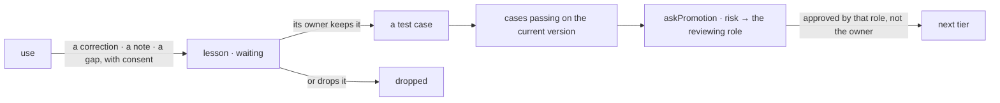

# Spec 105 — The lifecycle

Step **L7** of phase 9 (`docs/ROADMAP.md`; doctrine D-045, D-053): a skill, an agent or an app is
created by a person, used, learns from what its use taught, is evaluated by test cases, and is
promoted one tier at a time with a review by its risk. An agent at work has a job description, six
states, triggers, a budget, and autonomy earned by proofs — never taken.

## Why

The author's vision: a person who is not the skill's designer uses an agent, and the result
respects her organization's ways; the designer improves the skill from use, then follows the
promotion process to reach everyone. The same for agents and apps. Without one lifecycle, each
product invents its own — or none: a skill shared to the whole organization the day it is written,
an agent that grants itself more freedom, a correction lost.

## Requirements

- **FR-001 — Resources** (`@kete/lifecycle/server`): a skill, an agent or an app with its owner,
  version, tier and test cases (contract `resource.v1`); new, it starts at `me`; a new version keeps
  its tier and passes its cases again; a result for another version is ignored. RLS in the same
  migration.
- **FR-002 — Lessons** (contract `lesson.v1`): gathered only with consent; they wait for the owner,
  who keeps one — its case becomes a test case — or drops it; nobody else decides; decided, it is
  frozen by the database.
- **FR-003 — Tiers**: one at a time; the next tier asks 3, 5 or 10 cases, all passing; no lesson
  waiting; no review already pending; the owner asks with a risk — low to the team's lead, medium
  to the unit's head, high to an administrator, and the whole organization never below the unit's
  head; the reviewer holds that role and is not the owner.
- **FR-004 — An agent at work** (`@kete/lifecycle`, pure): six states and the signals between them —
  stopped is final, pause from any state; its budget (`ok`, `low` from 80 %, `exhausted`); what wakes
  it — a routine of `@kete/time` or an app's event with what its data must say — and when next;
  autonomy by proof: the last 20 decisions on a gesture, none refused, few corrected — a proposal to
  its owner.
- **FR-005 — Routines in one place** (`@kete/time`): `nextRun` and `Routine` move from
  `@kete/boards`, which re-exports them.
- **FR-006 — The parts** (`@kete/design`): `AgentCard` (mission, facts, budget meter, state,
  gestures with their levels and proofs, gestures of its owner), `LessonCard`, `TierLadder`.

## Proof

- `packages/lifecycle/tests/lifecycle.test.ts` (6): a lesson refused without consent, decided by its
  owner only — not by an agent, not by a colleague — and frozen; readiness that names what is
  missing; a version's results; asked by the owner, refused to herself and to the wrong role,
  approved by the team's lead; the next tier asking more, a new version passing again; isolated by
  organization; six states; budget; triggers and next wake; a proof on 20 decisions.
- `packages/design/tests/lifecycle.test.tsx` (3).
- In the design preview (« déléguer »): the Agent Relances waiting for a decision, its budget low,
  its next wake « lundi 19 octobre », the proof that it may write alone; Essi's lesson kept — the
  5th case — and « Relance polie » at « Mon équipe », what « Mon unité » asks.

## What stays for later

Déléguer in Kete Enterprise on these packages (C6, C7): the agents' cards, the skills' library with
lessons and promotion, the reviews in Décider; the cases run automatically on a new version
(`evaluateSkill`, `evaluateAgent`); an app's own lifecycle in Kete Cockpit.
