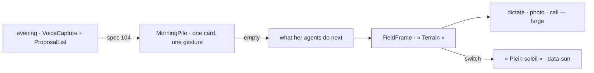

# Spec 106 — The phone

Step **L8** of phase 9 (`docs/ROADMAP.md`; doctrine D-051, D-054): the phone's own screens in the
shell — the morning's pile, decided with a thumb; « Terrain », the field mode with the next thing in
large; « Plein soleil », a screen read outdoors — and the evening's voice, from spec 104.

## Why

Most of the organizations Kete serves work from a phone, often outdoors: a site, a shop, a road. A
desktop page shrunk to a phone is a list to scroll and buttons too small for a thumb; under the sun,
a dark screen or a grey text cannot be read. The method (D-051) starts the day with what waits —
one thing at a time — and the person on a site needs the next thing and three large gestures.

## Requirements

- **FR-001 — The morning's pile** (`@kete/shell` `MorningPile`): what waits, one card at a time —
  where she is (« 2 sur 5 », as a progress bar for assistive technologies), the card, its gestures
  at least 48 px high, what comes next — and, once empty, what her agents go on doing.
- **FR-002 — « Terrain »** (`FieldFrame`): the next thing in large, large gestures (56 px at least),
  « Plein soleil » as a switch, and the way back; safe on a phone's edges.
- **FR-003 — « Plein soleil »** (`@kete/design`): `data-sun="on"` on the page wears each design's
  light mode at its strongest — surfaces in the surface's color, texts and lines in the text's,
  actions and states their own — over any mode; derived by the generator for every design, apps'
  own included, and its contrasts checked like the others. `useSunlight` sets it.
- Every word through props; nothing user-visible written in the packages.

## Proof

- `packages/shell/tests/phone.test.tsx` (3): the pile shows one card, where she is, what comes next,
  and not the next card's content; empty, what her agents do; « Terrain » with its switch, its
  gestures and its way back.
- `pnpm design:check`: both designs meet their contrasts in « Plein soleil ».
- In the design preview (« téléphone »), at 375 px: three cards approved with a thumb, « Tout est
  réglé », « Mode Terrain »; « Plein soleil » turns the dark workspace into its strongest light —
  white surfaces, black text and lines — with nothing wider than the screen.

## What stays for later

The pile and « Terrain » in Kete Enterprise (C2, C14) on the center's decisions and projects; the
report dictated and read back aloud; offline pages for « Terrain »; a native wrapper.
