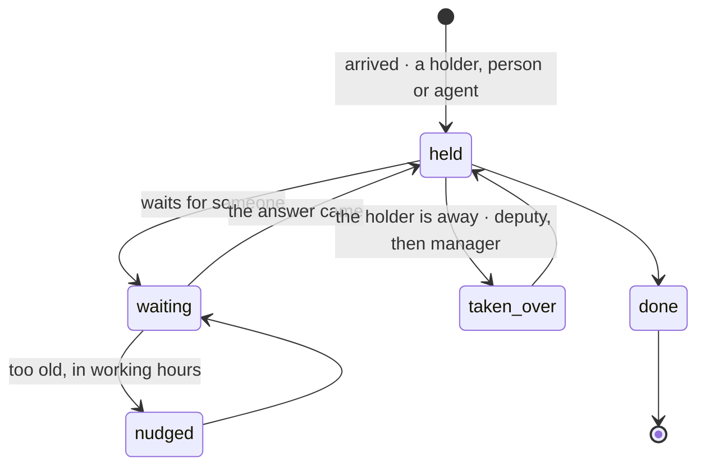

# Spec 111 — Holdings and the relay (`@kete/work`)

Step **U** of phase 10 (`docs/ROADMAP.md`; doctrine D-056; decisions 0011 and 0012). **Ready for
the author's go**; nothing is coded before it.

## Why

A company loses time where work waits between two people without anyone knowing. Kete Enterprise
has six ways of saying « a thing in progress » (requests, to do, meeting actions, circuit steps,
drafts, agent tasks), each with its own status and holder, and no view that gathers them: « who
holds what » has no answer. One holding, the same in every app, with a rule that it always has a
holder, is the piece that makes a company fluid.

## Contracts

- **`holding.v1`** (new): `id`, `organization`, `object` (`{ kind, id }`: project, party, quote,
  ticket…), `what`, `holder` (`{ kind: person | agent, id }`, required), `waiting_on` (a person, an
  agent, a party, or none), `since`, `due`, `state` (`held`, `waiting`, `done`), `source`
  (`{ app, kind, ref }`: where it comes from), `for` (`action` or `information`).
- **Events** (`event-data.v1` types): `holding.created`, `holding.waiting`, `holding.nudged`,
  `holding.taken_over`, `holding.handed_back`, `holding.done`.
- Reads: the structure's deputies and managers, absences as dated facts (`dated-fact.v1`).

## Requirements

- **FR-001 — The holding.** An app or the center says a holding through the contract; a holding
  without a holder is refused at the edge.
- **FR-002 — Never nobody.** A job checks continuously that every open holding has a holder; a
  breach is journaled and raised as a card to the organization's administrator.
- **FR-003 — The relay on absence.** When a holder is away on the day a holding is due (or today
  for a holding without a due date), it passes to the deputy, then to the manager, then to the
  organization's head; the new holder is told on his channels and may hand it back with a reason.
- **FR-004 — The relay on age.** A holding waiting on a party for longer than its policy's delay
  (two days by default) is offered to the agent in charge of nudges, in working hours only; a
  holding waiting on a person nudges that person once a day.
- **FR-005 — « Pour moi ».** One read for a person: what waits for her decision (cards), what she
  must answer, what she holds, what to classify — sorted by urgency and age.
- **FR-006 — Fluidity figures.** The oldest wait, the waits over 48 hours and with whom, the human
  time per sale, computed from the holdings and the journal.
- Every word through the product's catalogs; the holder's name is never computed by a model.

## Proof

- Tests on a Neon branch: a holding without a holder is refused; an absence moves its holdings the
  same day, through deputy then manager; a waiting holding is nudged in working hours and not at
  night; « Pour moi » gathers holdings from two sources.
- The simulation's scenario « Kossi sera absent vendredi » replayed as a test.

## Not done here

Kete Enterprise's six sources writing holdings (its spec 087); the screens (phase 10, step E).
