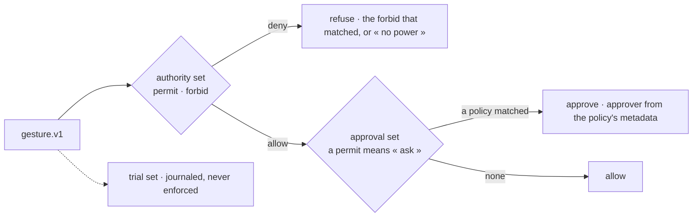

# Spec 112 — First check: Cedar on the six policies

Run on 2026-10-16 with `@cedar-policy/cedar-wasm` 4.13.0 (Node 22, Windows), before any code of
`@kete/policies`. It answers the first open question of decision 0012.

## How the three effects sit on Cedar

Cedar answers allow or deny. `policy-decision.v1` has three effects, so the engine holds three
policy sets, each a Cedar policy set of its own:



- **Authority**: what she may do at all; a `forbid` wins, nothing permitted means refused.
- **Approval**: a `permit` here means « this needs someone's approval ». The approver (a relation
  or a role: `manager`, `project.holder`, `direction`, the person an agent acts for) is the
  policy's metadata in `policy.v1`, resolved in TypeScript (absence → deputy, FR-004).
- **Trial**: evaluated on every gesture, its matches journaled as `trial`, never enforced (FR-003).

A person and an agent are two principal types; an agent's policies read
`principal.onBehalfOf`, so the same gesture goes through the same policies (FR-001).

## The six policies, as written for the check

```cedar
// 1. Who commits the company: signature powers. An agent never signs.
permit (principal is Kete::Person, action == Kete::Action::"contract.sign", resource)
  when { principal.signs };
forbid (principal is Kete::Agent, action == Kete::Action::"contract.sign", resource);
// approval: above 5 000 000 F, the direction
permit (principal, action == Kete::Action::"contract.sign", resource)
  when { context.amount > 5000000 };

// 2. Who speaks to clients, on which channel, with which templates, in which hours.
permit (principal, action == Kete::Action::"message.client", resource)
  when { ["whatsapp", "mail"].contains(context.channel) };
forbid (principal is Kete::Agent, action == Kete::Action::"message.client", resource)
  when { context.hour < 8 || context.hour >= 19 };
// approval: an agent writing outside an approved template asks its person
permit (principal is Kete::Agent, action == Kete::Action::"message.client", resource)
  unless { context.approvedTemplate };

// 3. Spending limits by role and project.
permit (principal is Kete::Person, action == Kete::Action::"purchase.commit", resource);
permit (principal is Kete::Agent, action == Kete::Action::"purchase.commit", resource)
  when { principal.level >= 2 };
// approval: over her limit (manager), over her person's limit (the person), over budget (holder)
permit (principal is Kete::Person, action == Kete::Action::"purchase.commit", resource)
  when { context.amount > principal.spendingLimit };
permit (principal is Kete::Agent, action == Kete::Action::"purchase.commit", resource)
  when { context.amount > principal.onBehalfOf.spendingLimit || context.amount > 200000 };
permit (principal, action == Kete::Action::"purchase.commit", resource)
  when { context.amount > resource.budgetLeft };

// 4. Deputies: the holder decides her card; her deputy while she is away.
permit (principal, action == Kete::Action::"card.decide", resource)
  when { principal == resource.holder ||
    (context.holderAbsent && resource.holder has deputy && resource.holder.deputy == principal) };

// 5. Retention and confidentiality.
permit (principal, action == Kete::Action::"document.read", resource);
forbid (principal is Kete::Person, action == Kete::Action::"document.read", resource)
  when { resource.confidential && !resource.readers.contains(principal) };
forbid (principal is Kete::Agent, action == Kete::Action::"document.read", resource)
  when { resource.confidential && !resource.readers.contains(principal.onBehalfOf) };
permit (principal is Kete::Person, action == Kete::Action::"document.delete", resource);
forbid (principal, action == Kete::Action::"document.delete", resource)
  when { context.ageDays < context.retentionDays };

// 6. Consent of outside contacts: STOP is final, for people and agents.
forbid (principal, action == Kete::Action::"message.client", resource)
  when { resource.optedOut || !resource.consent };
```

## Results

| What | Measured |
| --- | --- |
| Correctness | 17 of 17 gestures decided as expected: same gesture by Kossi and by his agent, an agent never signs, STOP refuses even the director, a confidential document refused to an agent through its person, a deputy decides only while the holder is away, approvals name their approver |
| Validation | Every policy validated against the schema in strict mode; a policy reading an attribute that does not exist is caught |
| Load | 71 ms to load the module (4.3 MB of WebAssembly, 1.4 MB gzipped) |
| Speed, without preparsing | 24 ms for one decision: the schema and the policies are parsed on every call — not acceptable |
| Speed, preparsed | 2.0 ms for one decision (three evaluations, nine entities), 0.8 ms per evaluation |
| Runtimes | Node build checked; a `web` build of the same WebAssembly exists for edge runtimes, not checked here |
| Contradictions | Cedar's symbolic analysis (`cedar-policy-symcc`) is not in the WebAssembly build |

## What follows for step P

- Cedar is kept: correct on all six policies, fast enough once the sets are preparsed
  (`preparsePolicySet`, `preparseSchema`, `statefulIsAuthorized`) and re-prepared when a policy
  changes. Entities are passed per gesture, only those the gesture touches.
- The proof « a contradiction between two policies is reported by Cedar's analysis » becomes: each
  policy set is checked against a table of gestures and their expected effects, in the tests and
  when an administrator saves a policy (the trial shows the rest). Cedar's symbolic analysis can
  join in CI later, outside the process.
- Amounts are `Long` in the currency's minor unit; Cedar's `decimal` is not needed.
