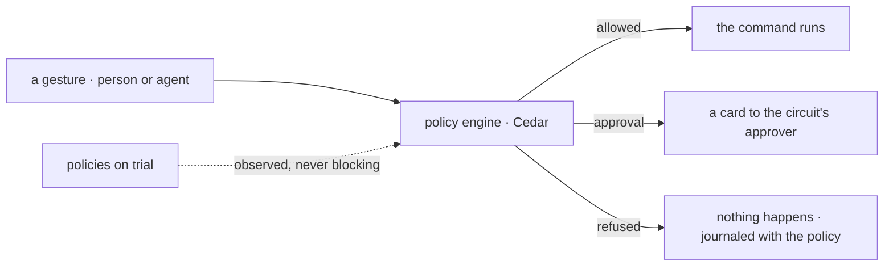

# Spec 112 — One policy engine at the gesture (`@kete/policies`)

Step **P** of phase 10 (`docs/ROADMAP.md`; doctrine D-058; decisions 0011 and 0012). **Ready for
the author's go**; nothing is coded before it.

## Why

Agents are going to write to clients and commit money. Kete Enterprise answers « who may do what,
up to how much, with whose approval » with two engines: circuits for people (`decisions`) and rules
for agents (`rules`). Trust needs one answer, the same for a person and an agent, journaled with
the policy that decided it.

## Contracts

- **`gesture.v1`** (new): `actor` (`{ kind: person | agent, id, on_behalf_of? }`), `kind`
  (`invoice.validate`, `message.client`, `purchase.commit`…), `amount` (money), `object`,
  `channel`, `party`, `template?`, `at`.
- **`policy-decision.v1`** (new): `effect` (`allow`, `approve`, `refuse`), `approver?`,
  `policies` (`[{ id, version, effect, reason }]`), `trial` (what policies on trial would have
  said).
- **`policy.v1`** (new): `id`, `sentence`, `rule` (Cedar text), `scope`, `owner`, `version`,
  `status` (`active`, `trial`, `off`).

## Requirements

- **FR-001 — Evaluate at the gesture.** One function, called by `@kete/commands` before a command
  runs, for people and agents alike; refusal wins over approval, approval over allow.
- **FR-002 — Policies as sentences.** An administrator writes a sentence; the model proposes its
  Cedar rule; a person validates it; the rule is versioned. Cedar runs in the process
  (WebAssembly).
- **FR-003 — On trial.** A new policy observes for a period: its decisions are journaled, never
  enforced, and shown to its owner.
- **FR-004 — Circuits.** An approval names its approver by relation or role (the project's holder,
  the manager, the finance head), from a threshold; an absent approver passes to the deputy.
- **FR-005 — The six policies** can be written: who commits the company (signature powers); who
  speaks to clients, on which channel, with which templates, in which hours; spending limits by
  role and project; deputies; retention and confidentiality; consent of outside contacts.
- **FR-006 — Explained.** Every decision says which policy, which version, why — in the journal
  and on the card.

## Proof

- Tests: the same gesture by a person and by an agent goes through the same policy; a refusal is
  journaled with its policy and version; a policy on trial never blocks; a contradiction between
  two policies is reported by Cedar's analysis.
- The simulation's scenarios « Kossi demande à l'agent », « le client écrit STOP » as tests.

## First check

Cedar's WebAssembly build (`@cedar-policy/cedar-wasm`) is evaluated first on the six policies:
size, speed, Node and edge runtimes. If it falls short, the engine keeps the same contracts on a
rule evaluator of our own.

## Not done here

Kete Enterprise's `decisions` and `rules` melting into it (its spec 088); the governance screens.
