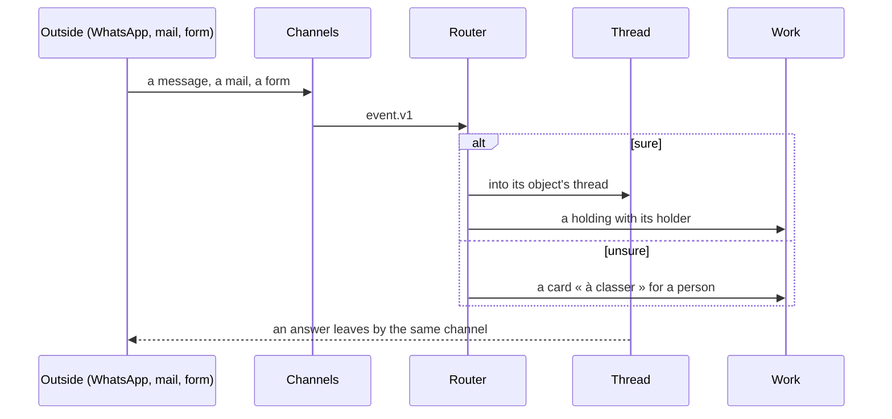

# Spec 113 — Threads, channels and the router (`@kete/threads`, `@kete/channels`)

Step **M** of phase 10 (`docs/ROADMAP.md`; doctrine D-056, D-057; decisions 0011 and 0012).
The author's go came on 2026-10-16 (« vas au bout proprement », « fais tout »). `@kete/threads`
and `@kete/channels` ship it (`packages/threads`, `packages/channels`); the cards with buttons on
WhatsApp and Telegram (FR-006) and asking the right person when information is missing come with
Kete Enterprise's spec 089.

## Why

Companies like KYA write mail mostly to keep a trace, and accept Kete threads with groups and
agents if they trace as well. Kete Enterprise talks in five places (the assistant, exchanges
between assistants, the phone, notifications, mail). One thread per object, groups, the mail and
WhatsApp bridged into them, and a router that ties every incoming event to its object — or asks
when it is unsure — replace internal mail and keep the outside on its own channels.

## Contracts

- **`message.v1`** (new): `id`, `thread`, `author` (person, agent, or contact through a channel),
  `text`, `attachments`, `for` (`action` or `information`), `via` (`kete`, `whatsapp`, `mail`,
  `telegram`, `form`), `edited_from?`, `at`.
- **`thread.v1`** (new): `id`, `object?`, `kind` (`object`, `group`, `direct`, `kete`), `holder`,
  `members`, `address?` (for replies by mail), `retention` (a policy).
- **`routing.v1`** (new): `event`, `object?`, `thread?`, `holding?`, `intent`, `confidence`,
  `asked?` (the card « à classer »).
- Reads and writes `event.v1`, `holding.v1`, `gesture.v1`.

## Requirements

- **FR-001 — Threads.** A thread is born with its object and is put away when it closes; groups
  from the structure (the board, a unit, a project's team) and created groups, each with a holder;
  direct threads; each person's thread with Kete.
- **FR-002 — The trace, at least as good as mail.** Each message is an event, never rewritten (an
  edit keeps the original); « read by » with its date; « for action » creates a holding, « for
  information » does not; members and subscribers say who knew and since when; attachments kept
  and versioned; full-text and meaning search; retention by policy; a thread exported as a
  timestamped PDF with its journal.
- **FR-003 — Channels.** WhatsApp (Meta's API: templates, 24-hour window, consent), Telegram, mail
  (IMAP with IDLE, SMTP from the person's own box), forms; each incoming item becomes `event.v1`.
- **FR-004 — Mail bridged.** A mail received lands in its object's thread; an answer from the
  thread leaves by mail from the person's box; a thread has its own address for replies; a daily
  digest by mail for whoever prefers mail, answered by mail.
- **FR-005 — The router.** Rules first (a known number, address or thread address), then the
  model's intent with a confidence; under the threshold, a card « à classer » for a person; a card
  classified becomes a rule. When information is missing, it asks the right person in one line.
- **FR-006 — Cards everywhere.** A gesture to decide appears in its thread, in « Pour moi », and on
  WhatsApp or Telegram with its buttons; settled in one place, settled everywhere.

## Proof

- Tests: a client's WhatsApp message lands in its project's thread with a holder; an unknown mail
  raises a card « à classer »; a reply in a thread leaves by mail and the answer by mail comes back
  into it; an edit keeps the original; an export carries the journal.
- KYA's examples as scenarios: « L'ordinateur de Phébé a un souci » (a holding for the IT holder,
  a drafted anomaly report, the asset's history); a quote request for a solar system through a
  form (a new client, a place, a holding « dimension and price », a card for the engineer).

## First checks

Meta's rules on AI assistants on the WhatsApp Business API, and whether to go through Meta
directly or an approved provider; KYA's mailboxes (IMAP at O2switch) reached from the server.

## Not done here

Kete Enterprise's assistant, exchanges, phone, notifications and mail melting into it (its spec
089); the screens (phase 10, step E).
