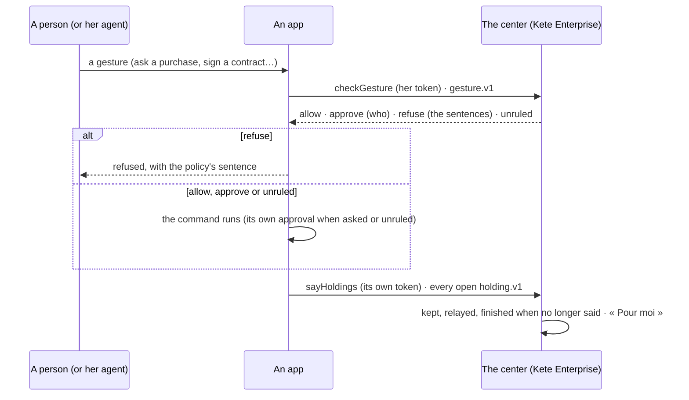

# Spec 114 — The apps on the living model (`@kete/center`, `@kete/work`, the template)

Step **A** of phase 10 (`docs/ROADMAP.md`; doctrine D-056, D-058; the doctrine's step A5). The
author's go came on 2026-10-17 (« Passe à A5 : les quatre apps du centre sur le modèle unifié »).
Kete Enterprise receives what the apps say in its spec 091; each app adopts it in its own spec.

## Why

Kete Enterprise now holds every thing in progress as a holding with its holder, and decides every
gesture with one policy engine (specs 111, 112). The apps behind the center — Kete Finance, Team,
Commitments, Support — still keep their own « en cours » and their own « qui peut quoi »: an
invoice waiting on its client, a leave sent back, a ticket waiting for its requester never reach
« Pour moi », nor the relay when their holder is away; a policy written at the center (« un agent
ne signe jamais ») does not stop the same gesture made in an app. One model means the apps say what
they hold and pass their gestures through the same policies.

## Contracts

- **`holding.v1`**: an optional `href` — where it opens, an https address of the app that says
  it, or a path of the center.
- Reads and writes `gesture.v1` and `policy-decision.v1` as they are.

## Requirements

- **FR-001 — The app says what it holds.** `center.sayHoldings(appToken, organizationId,
  holdings)` sends every open thing in progress of the app at once, with the app's own token
  (`kete:center`), to `PUT /public/apps/holdings`: each in the shape of `holding.v1`, under the
  app's product as its source (`holdingBody`). The center finishes the holdings the app no longer
  says.
- **FR-002 — A source in step.** `syncSource(db, organizationId, { app, said })` of `@kete/work`
  says again what changed, finishes what is no longer said, and keeps who stands in when the relay
  gave a holding to someone while its holder is away. Kete Enterprise's own six sources use it.
  `workLinksMigrationSql` adds the holding's `href`.
- **FR-003 — A gesture through the policies.** `center.checkGesture(token, gesture)` asks
  `POST /v1/apps/:product/gestures` with the person's token — and, for her agent, its id — before
  the app makes it. The verdict: `allow`; `approve`, with who approves by relation or role and the
  people found today; `refuse`, with the policies' sentences; `unruled` — nothing the organization
  wrote speaks of the gesture, or no center answered —, and the app follows its own rules. It never
  throws.
- **FR-004 — The template.** A new app says its holdings after every gesture of a screen and every
  minute from its worker (`platform/holdings.ts`, each feature's source — the example: open tasks,
  held by who wrote them); `platform/policies.ts` passes a gesture (`passGesture`, `sentencesOf`).

## Proof

- Tests: a source kept in step — said, unchanged, finished, relayed holder kept, a foreign source
  refused (`@kete/work`, on a test schema); a holding in the contract's shape, sent with the app's
  token; a verdict read with its sentences and approvers, and `unruled` without a center, a token
  or a readable answer (`@kete/center`); the template's open tasks said as holdings, a gesture
  asked for an agent and refused with its sentence.

## Not done here

The center's side (Kete Enterprise spec 091); each app's own holdings and gestures (their specs);
an approval of an app's gesture outside its circuits opened as a card by the center itself (today,
`approve` names who approves and the app takes its own approval path); a thread per app object.
