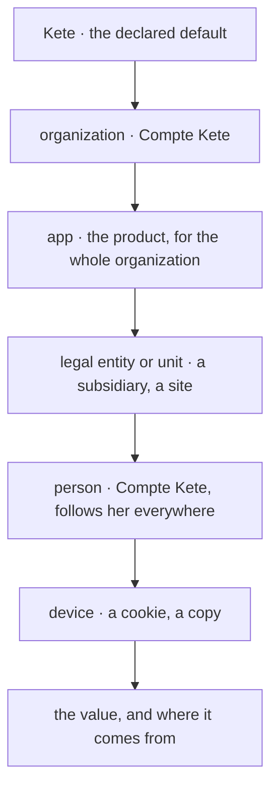

# Spec 115 — Settings in layers (`@kete/settings`, the Compte Kete, the template)

The first step of A6 in Kete's release (doctrine D-060; decision 0013). The author's go came on
2026-10-17 (« Je valide, suis le plan et continue »).

## Why

Each product read its language, currency and theme its own way, and the Compte Kete's generic
settings (D-013) were read by nobody. One concept, present everywhere, declared once by its owner,
resolved by layers, with its journal.

## Requirements

- **FR-001 — Declarations.** `defineSettings` takes settings each with a key (`kete.locale`,
  `prd_nettio.pickup_delay_hours`), a Zod schema, a default, the layers where it may be set, the
  permission that changes it at the organization, entity and app layers, its words (French and
  English), its group and its sensitivity. A key is declared once; a default must fit its schema; a
  secret cannot be declared. `describe()` gives the declarations as JSON Schema, for a manifest.
- **FR-002 — Kete's own settings** (`keteSettings`): the organization's identity (name, address,
  phone, e-mail, legal identifiers), language, time zone, currency, notification channels, working
  days and hours, holidays; the person's language, theme, time zone, quiet hours, reduced motion,
  text size, home page.
- **FR-003 — Resolution.** `resolve(registry, layers)` returns each value with the layer it comes
  from, the most precise layer winning; a stored value that no longer fits its schema, or is set on
  a layer the declaration does not allow, is skipped.
- **FR-004 — Storage in a product** (`settingsMigrationSql`): `kete_settings` (organization, layer
  `entity` or `app`, scope, key, value) with its RLS policy, and `kete_setting_events`, append-only.
  `setSetting` checks the layer and the schema, journals who changed what from what; `clearSetting`
  takes a value back to its inheritance; `readLayers` reads an organization's app layer and an
  entity's.
- **FR-005 — The Compte Kete.** The organization's layer is its generic settings (D-013) said as
  `kete.*` keys; the person's layer is her preferences (`user_preferences`, global). `GET
  /api/apps/settings` with a person's token returns both; `PUT /api/apps/settings` saves one of her
  preferences. Mon espace › Paramètres shows « Mes préférences ».
- **FR-006 — The client.** `createAccountSettings` reads both layers with the person's token, kept
  five minutes per token's hash (never the token itself), and saves a preference; without a Compte
  Kete or a token, the defaults.
- **FR-007 — The template** reads its settings through the module (`platform/settings.ts`): the
  person's theme and language from the Compte Kete, a choice of theme saved there.

## Proof

- Tests: declarations refused (twice the same key, a default out of its schema, a secret);
  resolution layer by layer with its provenance; a stored value out of schema skipped; storage with
  its RLS and its journal; the Compte Kete's API reads both layers and saves a preference; the
  client keeps a token's answer five minutes and falls back to the defaults; in the template, the
  theme she chose in another app wins over the device's old copy.

## Not done here

The « Réglages » panel generated from the declarations in `@kete/shell` (next); Kete Enterprise's
entity layer on its structure and the four apps moving their settings (next); the event
`settings.changed` pushed to the apps; the calendar's computations (working days between two
dates) in `@kete/time`.
