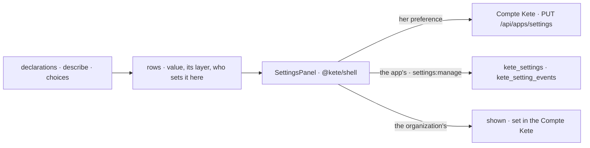

# Spec 116 — « Réglages », the same panel in every app

The second step of A6 (doctrine D-060: « Le même panneau « Réglages » est dans le cadre de chaque
app »; decision 0013), after spec 115. Run on the author's go of 2026-10-17 (« suis le plan de bout
en bout »).

## Why

Spec 115 gave every setting a declaration, a resolution by layers and its storage, but no screen
in the apps: a person could set her preferences only in Mon espace, and an administrator could set
nothing of an app's own. One panel, drawn from the declarations, the same in every app.

## Requirements

- **FR-001 — The words of a choice.** A declaration may say the words of each choice (`choices`, in
  French and English); `describe()` carries them. Kete's own say theirs: language, theme, text size,
  channels, working days.
- **FR-002 — The panel** (`SettingsPanel`, `@kete/shell`): her preferences first (« Pour moi »,
  they follow her in every app), then what is set for the organization, grouped by the
  declarations' groups. Each setting shows its name, its description, where its value comes from
  (Kete, the organization, the app, the entity, her, the device) and, when this screen sets it, the
  control its schema calls for: a list, a tick, a number, a text, ticks, hours. What no control fits
  is said in words, with where it is set. A change is saved at once and says so; a value set here
  can go back to what it inherits.
- **FR-003 — Who sets what.** A setting the person may set (`person` in its layers) is hers to set
  when a Compte Kete keeps her preferences; a setting the app may set (`app`) is set by whoever
  holds the app's `settings:manage`; the organization's are set in the Compte Kete.
- **FR-004 — The template** has « Réglages » at the foot of its places (`/reglages`): rows from
  `platform/settings.ts` (`settingRows`), her preferences saved in the Compte Kete, the app's set
  and cleared through `setSetting` and `clearSetting` — journaled — under `settings:manage`.

## Proof

- Tests: the control read from each schema (list, tick, number, e-mail, ticks of words and of
  numbers, nullable hours; what fits none is shown); the panel puts her preferences first, says
  each value's origin, offers to take back only a value set on its own layer, and says in words
  what is set elsewhere; the template's rows say who sets each setting for an administrator, for a
  member, and without a Compte Kete.
- The design preview (`?frame=settings-light`, `settings-dark`): « Réglages » in Kete Finance's
  frame, light and dark, a phone's width without horizontal scrolling, a change saved and said.

## Not done here

The entity layer's screen (a site, a subsidiary) in Kete Enterprise; the apps moving their settings
onto declarations (Kete Finance's and Support's currency first); a setting's history shown beside
it; `settings.changed` pushed to the apps.
