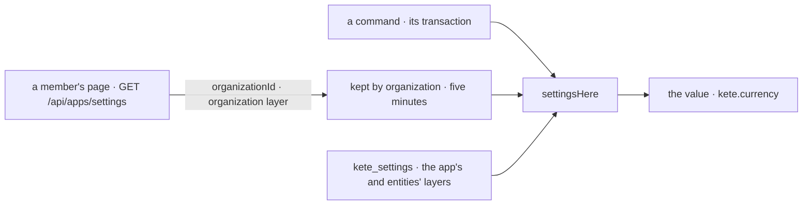

# Spec 117 — Settings where a command runs

The third step of A6 (doctrine D-060; decision 0013), after specs 115 and 116, and what the apps
need to move their settings off environment variables (Kete Finance's `FINANCE_CURRENCY`, Kete
Commitments' `COMMITMENTS_CURRENCY`, Support's `SUPPORT_CURRENCY`).

## Why

A screen reads its settings with the person's token. A command — called by a screen, an agent or a
job — runs inside its organization's transaction, often with no person's token at hand, and
still needs the organization's currency or a delay the app sets for it.

## Requirements

- **FR-001 — The Compte Kete says whose settings these are.** `GET /api/apps/settings` returns
  the token's `organizationId` beside the two layers.
- **FR-002 — The organization's layer kept by organization.** `AccountSettings.organization(id)`
  gives the organization's layer as one of its members last read it, five minutes at most; null
  when none did. A person's own layer is never kept by organization.
- **FR-003 — `settingsHere(db, registry, { organization, entityIds })`** resolves in the active
  organization's transaction: the app's layer and its entities' over the organization's when known,
  Kete's defaults otherwise — never a person's preference.
- **FR-004 — The template** has `settingsIn(db, organizationId)` for its commands.

## Proof

- Tests: the client keeps the organization's layer by its id and forgets it after five minutes;
  `settingsHere` lets the app's layer win over the organization's and falls back to Kete's default;
  the template's `settingsIn` reads the app's currency in one organization and the default in
  another.

## Not done here

The apps moving their own settings (each in its repository, on the released packages); an
organization's layer read by the app's own token when no member came lately; `settings.changed`.
