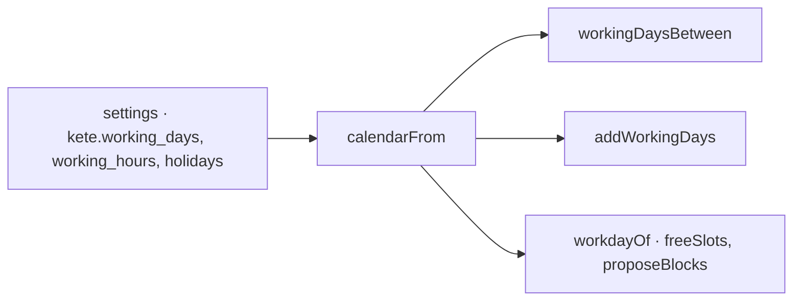

# Spec 118 — The organization's calendar

The last step of A6's common settings (doctrine D-060: « le calendrier de l'organisation (jours
ouvrés, fériés par pays, heures ouvrées) »; decision 0013), after specs 115 to 117. Run on the
author's go of 2026-10-17 (« vas au bout »).

## Why

Kete's settings declare the working days, hours and holidays (spec 115), but nothing computed with
them: a leave counted its week-ends, a due day fell on a holiday, the planner assumed Monday to
Friday.

## Requirements

- **FR-001** — `calendarFrom(settings)` reads the calendar from resolved settings: the
  organization's, or a unit's (a site that works Saturdays).
- **FR-002** — `isWorkingDay`, `holidayOn`, `workingDaysBetween(from, to)` (both included) and
  `addWorkingDays(day, count)` (forward or back, over week-ends and holidays).
- **FR-003** — `workdayOf(calendar)` gives the planner (`freeSlots`, `proposeBlocks`) the same
  days and hours.

## Proof

- Tests: a Friday worked, a Saturday and a holiday not; a leave from 2 to 6 November counts four
  days; a Saturday site counts five; Friday plus one working day is Tuesday after a holiday Monday,
  and back; a calendar without working days refused; the calendar read from settings and handed to
  the planner with Sunday as 0.

## Not done here

Holidays by country proposed to the organization (it enters its own today); the planner stepping
over holidays; `settings.changed` pushed to the apps.
