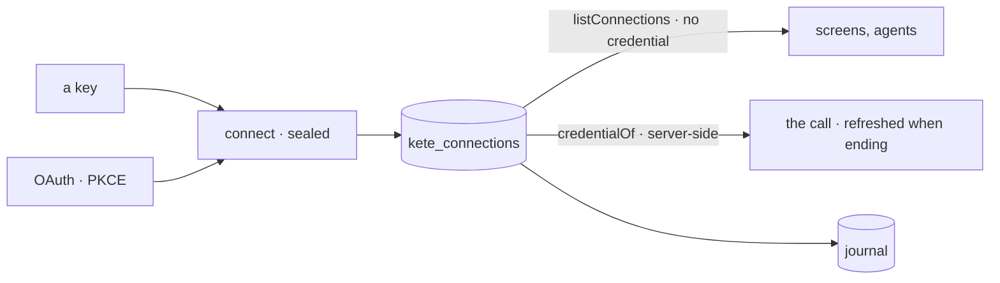

# Spec 119 — Connections (`@kete/connections`)

The first module of step B1 (phase 11 « Shipping Kete »; doctrine D-059: generalize at each
step), on the path to KYA's own account (D-060). Run on the author's go of 2026-10-17 (« vas au
bout »).

## Why

Kete Enterprise sealed its connectors' credentials itself (its spec 026), the apps carried their
own keys in environment variables, and the Cockpit and Pono will connect tools too. One module:
a tool connected once, its secret sealed and never shown, its health, refresh and revocation
journaled.

## Requirements

- **FR-001 — Sealing**: AES-256-GCM under the product's key (`createSealer`); without a key,
  nothing is kept; another key opens nothing.
- **FR-002 — Connecting** by a key or by OAuth: `startOAuth` (state, PKCE verifier kept by the
  caller, never in the address), `finishOAuth` (the return checked against the state, the code
  exchanged), on `oauth4webapi`.
- **FR-003 — Reading** never returns a credential; `credentialOf` opens it server-side and
  refreshes an OAuth token less than a minute from its end, sealing the new one; without a refresh
  token it asks to connect again.
- **FR-004 — Health and revocation**: `recordCheck` (healthy, or failing with the tool's words),
  `revokeConnection` (the credential wiped for good); every step journaled in
  `kete_connection_events`, append-only.
- **FR-005 — Storage** with its RLS policy in the same migration; no vendor named in the module.

## Proof

- Tests: sealing and refusals; the OAuth flow against a test authorization server (PKCE, state,
  forged return refused, refresh keeping the refresh token, refusal said); a key listed without its
  secret and opened for the call, unreadable under another key; an OAuth token refreshed near its
  end, expired without a refresh, failing then healed, revoked for good, every step journaled; the
  isolation of organizations.

## Not done here

Kete Enterprise's connectors and secrets moving onto the module; a connection's screen in the
shell; the other B1 modules (`@kete/metering`, `@kete/infrastructure`).
