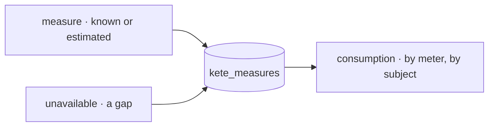

# Spec 120 — Metering (`@kete/metering`)

The second module of step B1 (phase 11 « Shipping Kete »; doctrine D-059), after spec 119. Run on
the author's go of 2026-10-17 (« vas au bout »).

## Why

Kete Enterprise counts its AI spend in tokens (`@kete/ai`), the apps count their usage events
(`@kete/analytics`), and Pono and the Cockpit will count sandboxes, branches, deployments and
instances. The phase's rule: « each figure known, estimated or unavailable ». One journal of what
was consumed, by whom, and how sure the figure is.

## Requirements

- **FR-001 — Meters** declared once (`<area>.<what>`, a unit, words); Kete's own: AI tokens and
  calls, sandbox minutes, deployments, storage, messages sent.
- **FR-002 — Measures**: a quantity, known or estimated, for a subject (a person, an agent, a
  project, an app, an instance), from a source, over a period; kept once per key; a source's
  silence recorded as unavailable with its reason — a gap, never a zero.
- **FR-003 — Consumption** between two moments, by meter and by subject: known when all was
  counted, estimated when one was, unavailable (at least) when a gap lies in the period.
- **FR-004 — Storage** append-only, with its RLS policy in the same migration.

## Proof

- Tests: meters refused (twice, a bad name, a bad unit, an unknown one); a retried measure kept
  once; a negative quantity refused; October's totals — tokens known, sandbox minutes unavailable
  with one gap; the day before the gap, estimated; tokens by subject; organizations isolated;
  measures never changed.

## Not done here

`@kete/ai`'s budget writing its calls as measures; the Cockpit's and Pono's sources; prices on
meters (after the KYA test, D-059).
