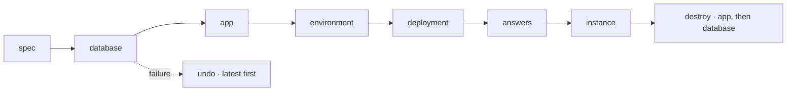

# Spec 121 — The provisioning port (`@kete/infrastructure`)

The third module of step B1 (phase 11 « Shipping Kete »; doctrine D-059; kete-core decision 0009:
a port ships with its adapter), after specs 119 and 120. Run on the author's go of 2026-10-17
(« vas au bout »).

## Why

The factory (spec 048) created a database on Neon and an app on Coolify with adapters of its own;
the Cockpit's fleet (B2) and the self-service deployment in Mon espace (B3) need the same, and
destroying, which nobody did. One port, its adapters, and an instance that is never left
half-built.

## Requirements

- **FR-001 — The port**: `Databases` (create with owner and application roles; destroy) and
  `Hosting` (ensure an app, set its environment, deploy, its state, destroy). Twice is harmless;
  so is destroying what is gone.
- **FR-002 — `provisionInstance`**: database, app, environment (the database's addresses among
  its secrets), deployment, until it answers or a deadline; each step said as it starts and ends;
  a failure undoes what was made, the latest first, and names what could not be undone.
- **FR-003 — `destroyInstance`**: the app, then the database, through the port alone.
- **FR-004 — Adapters**: Neon and Coolify (moved from the factory, the factory now using them),
  and the port in memory.

## Proof

- Tests: an instance created, answering, destroyed, each step said, twice harmless; a failed
  deployment undoing the app then the database; an instance that never answers given up and
  undone; Coolify's calls — create, environment, deploy, state, destroy, gone harmless — and its
  states in the port's words; Neon's calls and SQL — the owner and application roles created, then
  dropped with the database. The factory's tests on the package's adapters.

## The proof on real accounts (2026-10-17)

Run on the author's word (`tooling/scripts/prove-provisioning.ts`): Support's `dev` branch as the
instance, a database on the kete-core project's `test` branch of Neon, an app in Coolify's
project Kete (staging), served at `<name>.13.140.178.49.sslip.io`.

| Run | What happened |
| --- | --- |
| 1 | Created and answering `healthy` at 146 s; the app destroyed; the database's removal refused — PostgreSQL 16 does not give a role's creator its privileges, so `drop owned by` failed. Finished through the port once fixed (the owner takes the role first). |
| 2 | Created and answering at 136 s; the application role and the database gone; the owner role refused (422) while Neon still applied the database's removal. Finished through the port once fixed (a pause, then retries while Neon is busy; an absent database never connected to). |
| 3 | Created, answering `healthy` at 146 s (database up, 12 ms), destroyed at 152 s: no database, no role, no app left; the address no longer answers. |

## Not done here

Backups and restoration (step B2, the Cockpit's fleet); object storage and DNS adapters (Coolify
serves the domains today).
