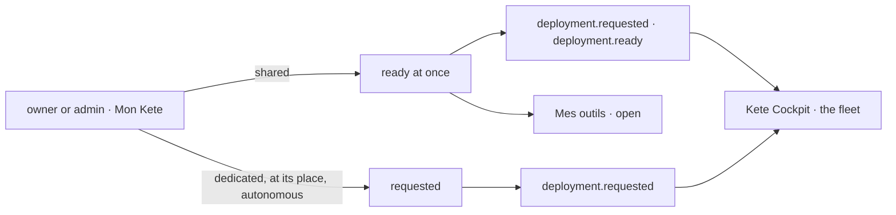

# Spec 123 — My Kete: an organization deploys its Kete itself

Step B3 of phase 11 « Shipping Kete » (the doctrine's « La sortie de Kete 1.0 »: « une entreprise
s'inscrit, choisit son mode (partagé, dédié, chez elle, autonome), sa région, ses apps ; paie ; son
Kete est prêt »), on the path to KYA's own account (D-060). Run on the author's go of 2026-10-17
(« continue l'app jusqu'au bout »).

## Why

Kete Enterprise served any organization of the Compte Kete, but nothing led an organization to
it: no place to choose how it runs, no address in « Mes outils », and Kete's fleet heard nothing
of what an organization wanted.

## Requirements

- **FR-001 — Events** (contract `event-data.v1`): `deployment.requested` (deployment, product,
  mode, region, apps) and `deployment.ready` (deployment, product, mode, address), standard events
  of the SDK; the Compte Kete declares them in its manifest.
- **FR-002 — Deploying**: its owner or an administrator chooses a mode, a region among
  `KETE_DEPLOY_REGIONS` (Kete's own without it) and the apps beside it (Kete Finance, Team,
  Commitments, Support). **Shared** is ready at once at `KETE_ENTERPRISE_URL`, with no gesture of
  Kete's, and says so; the other modes are requests for Kete's fleet. Once one runs, another mode
  asked is kept beside it, once.
- **FR-003 — Storage**: `deployments`, one per organization and product, isolated per
  organization (migration 0012).
- **FR-004 — Screens**: « Mon Kete » (`/espace/kete`) in Mon espace's places; Kete Enterprise first
  in « Mes outils », opened at its address once ready, « Déployer » otherwise.

## Proof

- Tests: the regions read from the configuration, Kete's own without it; a member refused; shared
  ready at once with its two events; the same mode refused, another mode asked once beside it;
  shared refused without a shared instance, an unknown region refused, a request in autonomous mode
  with its event; organizations isolated; the manifest's events.
- Seen in the Compte Kete (local, on the test database): a new organization deploys in shared mode
  with Kete Finance beside it and finds « Prêt », its date and its apps; asks dedicated and reads
  that Kete prepares it; « Mes outils » opens Kete Enterprise at the shared address.

## Not done here

Paying (step B4, after KYA's test, D-059); the fleet making a dedicated, at-its-place or autonomous
deployment (step B2, on `@kete/infrastructure`); an Enterprise instance of several apps through the
provisioning port.
