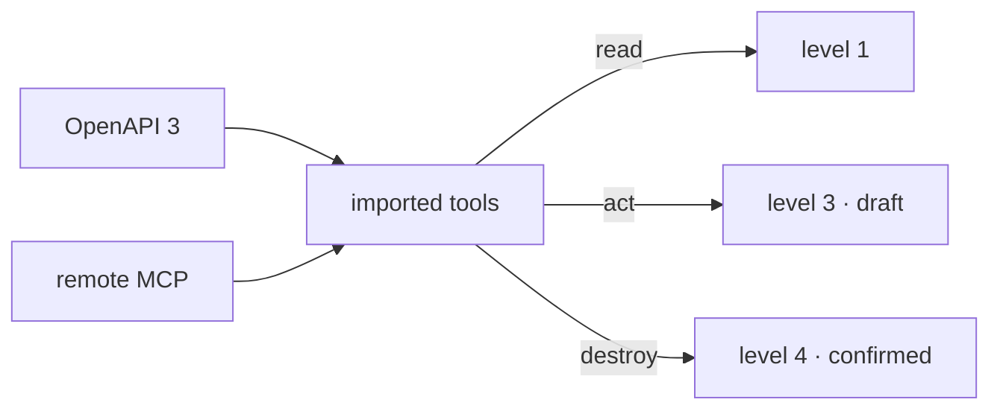

# Spec 124 — An organization's own tools, imported (`@kete/tools`)

The first part of step C4 (doctrine D-060: « des agents à niveau … l'import d'outils (OpenAPI,
serveurs MCP distants) … toujours sous les politiques, les gestes engageants en brouillon »), on the
path to KYA's own account. Run on the author's go of 2026-10-17 (« continue l'app jusqu'au bout »).

## Why

Kete Enterprise's connectors read one tool of an MCP server; an agent could not use a company's
own tools — its CRM's API, its ticketing — the way consumer assistants do. One module turns a
tool's own description into Kete capabilities, so the agents use them under the same rules.

## Requirements

- **FR-001 — OpenAPI 3**: each operation an imported tool, named `<prefix>_<operation>`, its
  path, query and header parameters and its JSON body one input object (local references
  resolved, cycles cut); an `Authorization` parameter is never an input; `GET`/`HEAD` read,
  `DELETE` destroys, the rest acts. `callOpenApi` fills the path, query and headers, sends the
  body, with the connection's credential.
- **FR-002 — Remote MCP**: `connectMcp` (Streamable HTTP, the connection's token), `toolsFromMcp`
  (read-only when the tool says so; destructive unless it says otherwise, MCP's default),
  `callMcp` (its structured answer, or its text; an error refused).
- **FR-003 — Capabilities**: `toolCapabilities` — a read at level 1 (`tools:read`), an act at
  level 3 with a draft `imported_tool_call` (`tools:act`), a destruction at level 4; input
  checked from the tool's JSON Schema; answers `confidential`.

## Proof

- Tests: KYA's CRM described by OpenAPI imported (names, effects, references, the cycle cut, the
  credential parameter dropped; not OpenAPI 3 refused); a create and a list called with the
  connection's credential, a refusal said; a ticketing MCP server's tools with their effects,
  called, an error refused; a real MCP server over HTTP reached with the credential, imported and
  called; the capabilities' levels, permissions, drafts and commands; an input checked.

## Not done here

The screen where an administrator imports a tool and connects it (Kete Enterprise, on
`@kete/connections`); the other parts of C4 — web search, the voice answer and the call, a
computer in the sandbox, sub-agents.
