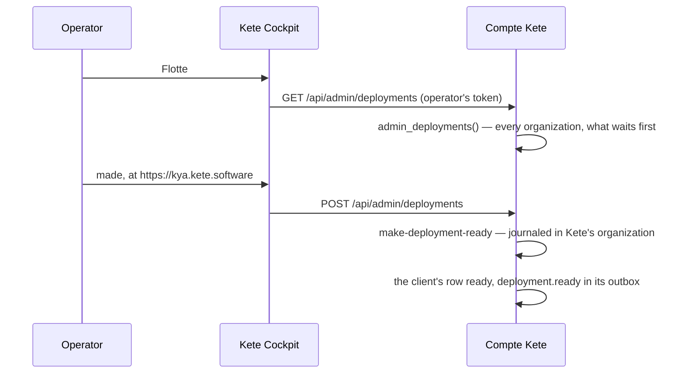

# Spec 125 — Kete's fleet reads and makes the deployments

The Compte Kete's part of step B2 (phase 11: « La Flotte : provisionner, suivre … sans jamais lire
les données d'un client »), after spec 123. Run on the author's go of 2026-10-17 (« construis la
Flotte (B2) »). Its screen is in Kete Cockpit (kete-cockpit, « Flotte »).

## Why

« Mon Kete » records an organization's requests and announces them, but Kete's operators could
neither see them together nor tell an organization that its Kete was made. The Compte Kete stays
the one source of a deployment; Kete Cockpit reads it and says what Kete made.

## Requirements

- **FR-001 — Reading** (`GET /api/admin/deployments`, a Kete operator's token): every
  organization's deployment, its organization's name, mode, region, apps, state, address and the
  mode asked; what waits for Kete first. Through an owner's function, the only way across
  organizations.
- **FR-002 — Making** (`POST`, `{ deploymentId, url }`, an https address): a request becomes
  ready; a running one asked in another mode moves to it; nothing left to make is refused (409),
  an unknown deployment too (404). A journaled command in Kete's organization; the client's row
  and its `deployment.ready` written in the client's organization, in the same transaction.
- **FR-003 — Described** in the Compte Kete's OpenAPI.

## Proof

- Tests: two organizations' deployments read together, the request first; a dedicated request
  made — ready at its address, `deployment.ready` in its client's outbox, the command in Kete's
  journal; nothing left to make refused; a running shared deployment moved to the dedicated mode
  asked; an unknown deployment and a plain-http address refused.

## Not done here

Making a dedicated instance through the provisioning port (an instance of several apps); the
fleet's watch (health, version, backups restored, incidents, consumption).
