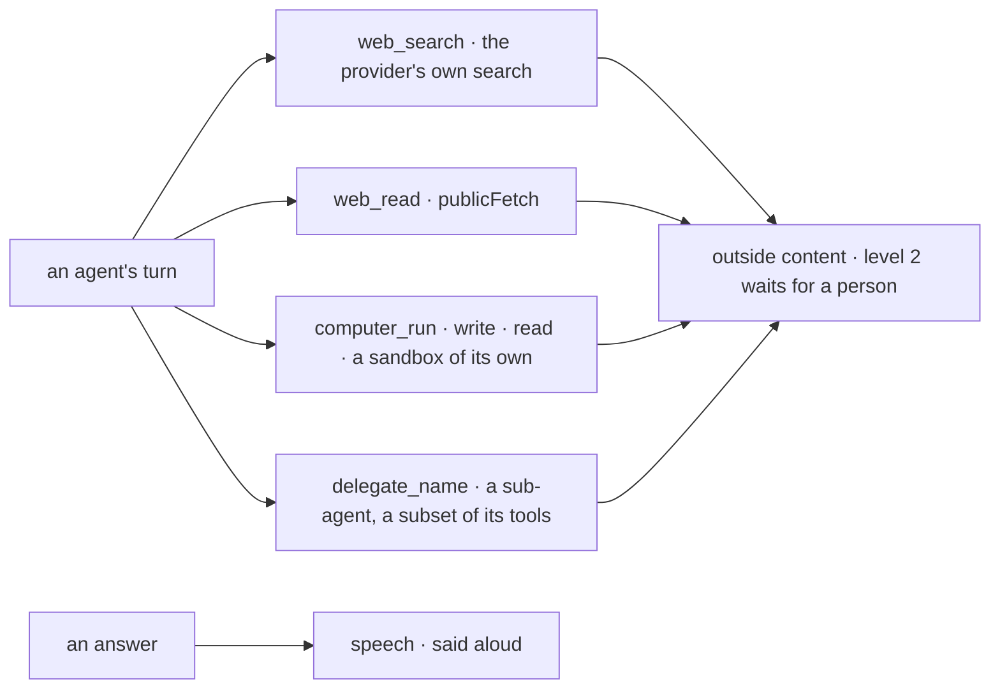

# Spec 129 — Agents with abilities beyond the product

C4 of Kete's release, second part (doctrine D-060: « Des agents à niveau : recherche sur le web,
réponse à voix haute et appel, import d'outils OpenAPI et MCP, un ordinateur dans le bac à sable,
sous-agents ; sous les politiques »). The import of tools is spec 124. Run on the author's word of
2026-10-18 (« vas au bout de tout le plan … Sois autonome »).

## Why

An agent knew the product's capabilities and nothing else: it could not look a price up on the web,
read the page a client sent, run a computation, hand a part of a task to another agent, nor say its
answer aloud.

## Requirements

- **FR-001 — Web search** (`@kete/ai`): a port on the model provider's own search tool (OpenAI,
  Anthropic) — no search service added; a summary and each source once; metered.
- **FR-002 — Reading a page** (`@kete/agents`, `@kete/tools`): `web_read` reads a page as text
  through `publicFetch` — https, every resolved IP public, no redirection, a timeout, a bounded
  answer; scripts and styles dropped.
- **FR-003 — A computer of its own** (`@kete/agents` on `@kete/sandbox`): `computer_run`,
  `computer_write`, `computer_read` on one sandbox per conversation, created on first use, kept,
  without the organization's secrets; no path climbs out.
- **FR-004 — Sub-agents** (`@kete/agents`): `AgentTurn.subAgents`; `delegate_<name>` hands one task
  to an agent with only the named tools among the turn's own, the same metering, no sub-agent of its
  own; the outside content it read counts for the turn that delegated.
- **FR-005 — Under the policies**: each ability is a tool the host adds beside its capabilities, so
  its policy engine sees it like any other; each brings outside content (`OUTSIDE_ABILITIES`): once
  one ran, nothing acts at once in that turn (spec 090).
- **FR-006 — Said aloud** (`@kete/ai`): a speech port on any speech model of the AI SDK — OpenAI's,
  Mistral's Voxtral (open weights); what a page shows but a voice does not say is dropped, a long
  answer cut at a sentence; metered.

## Proof

- `packages/ai/tests/voice-and-web.test.ts` (5): the words said without links or code, counted, none
  when the budget is spent; OpenAI's or Mistral's voice by configuration; a search's summary and its
  sources once each, counted; the provider's own search or none.
- `packages/agents/tests/abilities.test.ts` (6): a search with its question checked; a page read as
  text, https only, and a loopback address never read; one sandbox per conversation, kept, no path
  out; a sub-agent offered only the tools the agent holds among those named for it; a sub-agent that
  read the web stops its parent's immediate gesture.
- `packages/tools/tests/tools.test.ts`: loopback, private, link-local and http addresses refused.

## Not done here

Phone calls with an agent: they wait for the author's choice of how Kete reaches telephony
(decision 0012). Kete Enterprise wires the abilities to its assistant in its own spec.
