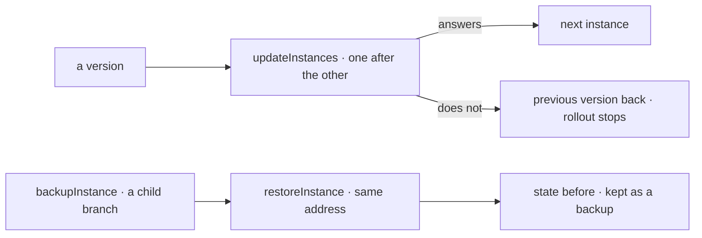

# Spec 131 — Updates and backups through the provisioning port

Phase 11, step B2 (doctrine « La sortie de Kete 1.0 », voie B: « La Flotte : provisionner, suivre
(santé, version, sauvegardes restaurées, incidents, consommation), mettre à jour, revenir en
arrière » ; preuve : « Une mise à jour poussée à deux instances, une sauvegarde restaurée »). Builds
on spec 121 (`@kete/infrastructure`). Run on the author's word of 2026-10-18 (« vas au bout de tout
le plan … Sois autonome »).

## Why

The port created and destroyed an instance; Kete's fleet could neither move instances to a new
version — nor back when one breaks — nor take a backup and bring an instance back to it.

## Requirements

- **FR-001 — A version**: `Hosting.version`, `pin` (a commit or a tag; null follows the branch),
  `deploy` gives the deployment's id and `deployment` follows it; `restart`.
- **FR-002 — Updates**: `updateInstances(ports, instances, version)` pins, deploys and waits for
  each instance to answer, one after the other; one that fails or stays silent gets its previous
  version back and the rollout stops; each instance's outcome is said (`updated`, `rolled_back`,
  `failed`, `skipped`).
- **FR-003 — Backups**: `Databases.backup`, `backups`, `restore`; on Neon with `branchPerDatabase`,
  a database on its own branch, a backup a child branch (copy-on-write, no compute), a restore
  Neon's branch restore at the same address with the state just before kept as a backup; the
  family deleted leaf first. Without a branch per database, backups are refused.
- **FR-004 — Restoring an instance**: `restoreInstance` restores its database, restarts it so its
  connections renew, and waits for it to answer.

## Proof

- `packages/infrastructure/tests/operate.test.ts` (5): an update reaching two instances; a broken
  version taken back and the rollout stopped; a silent one taken back; a backup restored, undone by
  another; Neon's branch family made, restored and deleted leaf first as Neon re-parents it;
  Coolify's pinned commit, deployment and restart.
- Live, `tooling/scripts/prove-fleet.ts`, run on 2026-10-18 (974 s): two instances of Support on
  Kete's Neon (a branch each, from `test`) and Coolify; version `84c137c` pushed to both (each
  updated and answering), then `2d96026` (each updated from `84c137c`, answering); a table written,
  a backup taken (`…--bk-20261018T030438`), the row changed, the backup restored in 16 s — the row
  as it was before, the instance answering, the state before kept as `…-before`; both instances
  destroyed, no longer answering, no branch nor application left.
- Neon's behaviour was probed first on branches without compute: a branch restored from its own
  child is accepted, and re-parents the family.

## Not done here

The Cockpit's « Flotte » screen pushing a version and restoring a backup (kete-cockpit); scheduled
backups; a deployment's own health beyond its `/health`.
