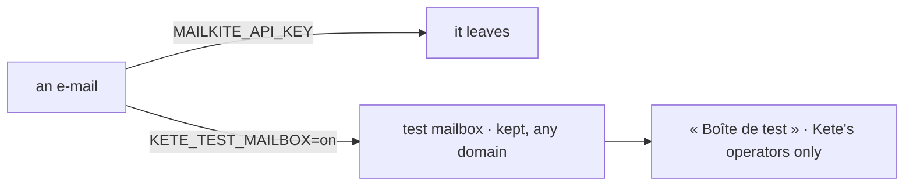

# Spec 132 — The test mailbox

Phase 11, toward E5 (« les vrais comptes branchés ») on staging. Asked by the author on 2026-10-18:
« il faut que tu gères les mails avec tout domaine pour test ».

## Why

Staging has no mail provider: an invitation or a new password's link never arrived, so the flows
that need an e-mail could not be tried, whatever the address.

## Requirements

- **FR-001** — `@kete/notify` `testMailbox()`: an e-mail sender that keeps what it is given, to any
  domain, the latest 200, in memory; `emailSenderFromEnv` chooses it with `KETE_TEST_MAILBOX=on` and
  no provider key (one per process). A provider key always wins.
- **FR-002** — The Compte Kete shows the kept e-mails in Mon espace › « Boîte de test »
  (`/espace/boite-de-test`), links clickable, to Kete's operators only (second factor on); never in
  production.

## Proof

- `packages/notify/tests/notify.test.tsx`: e-mails to any domain kept, the latest first and the
  latest only; chosen by the environment, one per process, a key wins.
- `apps/account/tests/test-mailbox.test.ts`: a new password's link to any domain kept and readable;
  nothing in production; nobody reads it without being an operator.

## Not done here

The same page in Kete Enterprise and the apps (their own e-mails); a mailbox kept across restarts.
