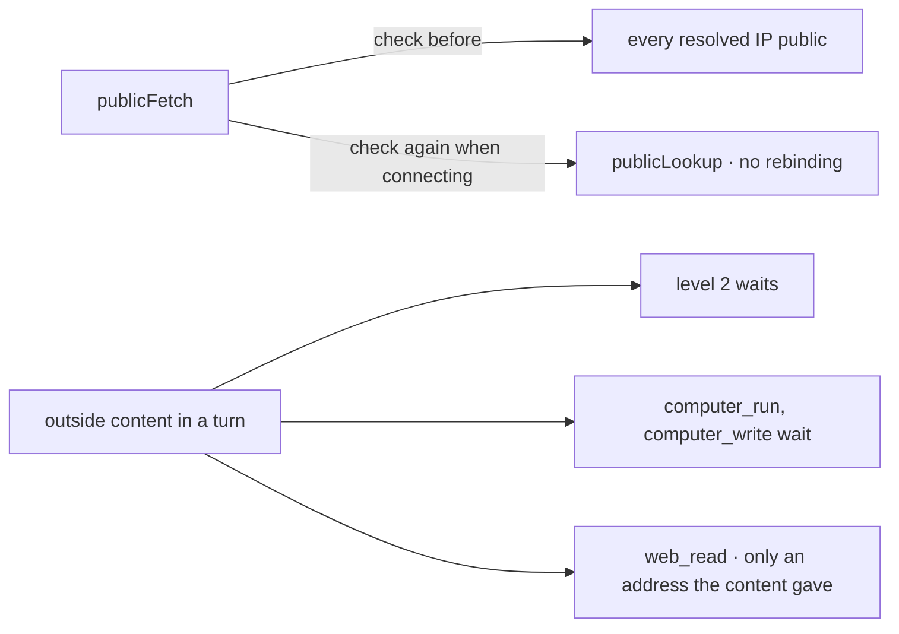

# Spec 134 — Security review fixes (phase 11, step E4)

The review of 2026-10-18 (`docs/security/review-2026-10-18.md`) found two ways out of the
organization through what phase 11 opened; this spec closes them.

## Requirements

- **FR-001** — `@kete/tools` `publicFetch` checks the address again at connection time
  (`publicLookup`, an `undici` agent) and cuts a body beyond `PUBLIC_LIMIT` even without
  `Content-Length`.
- **FR-002** — `@kete/agents` `outsideTurn`: once outside content is in a turn, a level 2 gesture,
  `computer_run` and `computer_write` wait for a person, and `web_read` reads only an address the
  outside content gave; `runAgent` (sub-agents sharing the watch) and `guardOutside` use it.

## Proof

- `packages/tools/tests/tools.test.ts`: a name resolving to a private address refused at
  connection time; a live check read `https://example.com` and refused `https://127.0.0.1`.
- `packages/agents/tests/abilities.test.ts`: after a search whose summary carries instructions, its
  source is read, a made-up address is not, and the computer waits.
