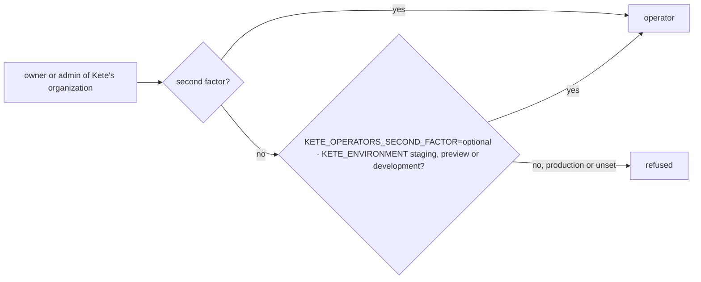

# Spec 135 — Operators without a second factor, on staging only

Asked by the author on 2026-10-18 (« sois flexible sur la double auth afin de faire tous les
tests »): on staging, a Kete operator may sign in with a password alone, so every flow is tried
without an authenticator app.

## Requirements

- **FR-001** — `@kete/admin` `secondFactorWaived()`: true only with
  `KETE_OPERATORS_SECOND_FACTOR=optional` and `KETE_ENVIRONMENT` staging, preview or development;
  `createOperatorGuard` accepts an operator without a second factor then.
- **FR-002** — The Compte Kete's `isOperator` (operator scripts, the fleet, the test mailbox) and
  Kete Cockpit's sign-in follow the same rule.
- **FR-003** — Tokens keep saying the truth: `two_factor` is not set for an account without one.

## Proof

`packages/admin/tests/admin.test.tsx`: an operator without a second factor admitted on staging
with the switch; refused in production, without an environment, and without the switch.
