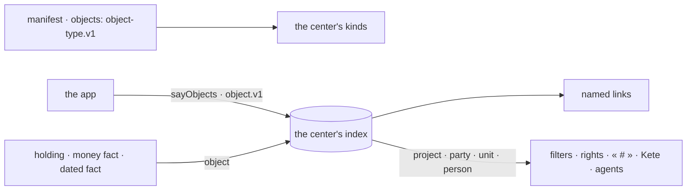

# Spec 142 — Objects at the center

Doctrine D-062 puts the object at the center (R1): everything that matters is an object, with its
thread, a person who answers for it, and four axes — project, party, unit, person — that every fact
about it inherits (R2), so that « filter by project » works everywhere. Today the center knows its
projects and third parties, and the apps' objects only through the threads they open
(`openObjectThread`). Nothing lists the kinds of objects, links two objects by name, or filters a
fact by an object that is not a project. ADR 0014 decides how: kinds declared once, a thin index in
the center, named links, axes inherited — never a copy of an app's data.

## Requirements

- **FR-001 — A kind, declared once.** `object-type.v1`: a kind's name, its words, its states (in the
  order of its life; a closed state ends it), which axes it carries, its named links to other kinds,
  where one opens, how far its title travels. An app declares its kinds in its manifest's
  `objects`; the center declares its own references the same way.
- **FR-002 — An object, said to the index.** `object.v1`: its kind and identifier, title, state, the
  four axes, its named links, where it opens, when it last changed, `gone` to take it out. Never its
  data.
- **FR-003 — Facts point to their object.** A money fact and a dated fact may name their `object`
  (additive); a holding already does.
- **FR-004 — The center client.** `sayObjects(appToken, organizationId, objects)` says up to 500
  objects with the app's own token; `objects(token, query)` finds what she may read by words, kind,
  axis or state; `object(token, kind, id)` reads one with its named links both ways and its thread.
  None throws: without a center, a token or her right, an empty answer or the reason.

## The flow

## Proof

- Contract tests: a kind and an object valid; a wrong kind, an unknown axis, an `href` without
  `{id}`, an object carrying data refused.
- Client tests against a fake center: said with the app's token, at most 500, found by words and
  axes, one read with its links, alone without a center.
- Kete Enterprise (its spec 100) keeps the index, its kinds and its rights; Support says its tickets.
