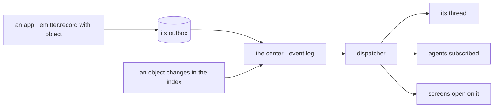

# Spec 143 — One event path

Doctrine D-062 (R11): an object that changes says so, and whoever depends on it learns it — its
thread, the agents that follow it, the screens open on it. ADR 0017 decides the path: one event log
in the center, a dispatcher, declared subscriptions, consumers that act once. This core spec gives
the contract its missing piece: an event names the object it is about.

## Requirements

- **FR-001** — `event.v1` gains an optional `object {kind, id}` (additive within v1).
- **FR-002** — `@kete/sdk`'s `createEvent` and emitter accept `object` and validate it.

## The flow

## Proof

Contract tests: an event with an object is valid; a malformed object is refused.
Kete Enterprise (its spec 101) keeps the log, the subscriptions and the dispatcher.
