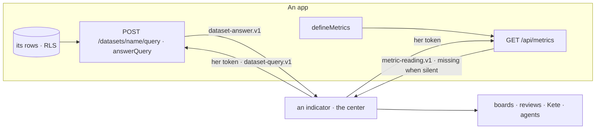

# Spec 144 — The Measure

Doctrine D-062 asks one system for figures: live and proven (R7), filtered by the four axes (R2),
declared once (R3), shown missing rather than zero (R17). ADR 0015 decides one Measure in four
layers — sources, indicators, readings, freezes. This core spec gives the sources what they lacked:
the four axes on an app's data set, a question summed up where the rows live, and a figure that says
it is missing.

## Requirements

- **FR-001 — A data set carries its axes.** `dataset.v1` gains `axes` (which fields are the project,
  the party, the unit, the person, the object); `defineDataset` checks they are fields of its rows.
- **FR-002 — A question, summed up at home.** `dataset-query.v1` (the center's axes, the data set's
  own fields, up to three groups, up to six measures, a period, a limit) and `dataset-answer.v1`
  (the groups, the rows counted, the axes applied, the moment). `@kete/capabilities` serves
  `POST {api}/datasets/{name}/query` under the caller's rights; only the answer travels.
- **FR-003 — One engine.** `@kete/metrics`' `answerQuery` is the only aggregation: the apps' data
  sets and the center's own tables use it.
- **FR-004 — Missing is not zero.** `metric-reading.v1` gains `missing`; `readMetrics` gives each
  figure asked by name as missing when its app does not answer; `queryDataset` answers `missing`.
- **FR-005 — The fourth axis.** `metric.v1`'s axes and a reading's filter gain the unit.

## The flow

## Proof

`@kete/metrics` tests: a question filtered on the axes the data set carries (and only those), its
own fields and its period; the largest group first, cut and said; nothing to count; refusals; a
question put with her token; missing when the app is silent or breaks the contract.
`@kete/capabilities` tests: `POST /datasets/{name}/query` sums up the caller's organization's rows
only, filtered on a project, and refuses an unknown field, a sum of words, a set not allowed.

Kete Enterprise (its spec 102) keeps the indicators, their structured sources, the readings with
their provenance, the freezes and the colour's consequence.
