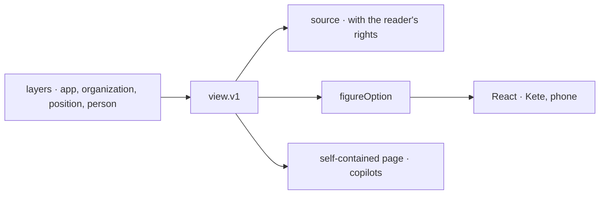

# Spec 145 — Components configured where they are used

Doctrine D-062 (R22): a few generic components configured at the place they serve, the
configuration being versioned data — never code nor SQL — at three levels (the app's default, the
organization and its positions, the person's own version), rendered the same in Kete, on the phone
and in the copilots. ADR 0016 decides one contract, `view.v1`, and two renderers in `@kete/views`.

## Requirements

- **FR-001 — One contract.** `view.v1`: a kind (`card`, `collection`, `figure`, `board`, `form`,
  `timeline`), a title in both languages, a source (an object kind, a question to a data set, an
  app's figure, indicators, a read tool — one at a time), the context the place binds, filters on
  the source's own fields, actions (capabilities: what commits is a draft), shortcuts, and the
  options of its kind. No query, no code.
- **FR-002 — The figures.** The charts of today (number, bar, line, pie, table) and the first
  added: bullet, indicator scorecard, bar and line combined, cumulative against a trajectory,
  waterfall, tile map, Pareto, radar, box plot — built by pure functions, the same rows always the
  same drawing.
- **FR-003 — Layers.** The most precise layer wins whole: her version, her position's, the
  organization's, the app's.
- **FR-004 — The React renderer.** ECharts loaded only when a chart is shown, following the theme;
  the bullet, the tile map, the states (loading, empty, missing, denied, stale) and the provenance on
  demand, every word given by the place.

## The flow

## Proof

`@kete/views` tests: a board holding a scorecard of indicators and a Pareto of an app's data set is
valid; an unknown chart, two sources at once, a word without its English, a query are refused; the
layers' order; the place's binding; each chart's option from known rows (bars with the period before
and the target lines, the running total and its trajectory, the waterfall's floating bars, the
Pareto's order and share, the box plot's outliers, the bullet's geometry).

Kete Enterprise (its spec 103) keeps the configurations' versions, lets Kete change a view on a
sentence with undo, and draws the board of canvas v7 with these components.
