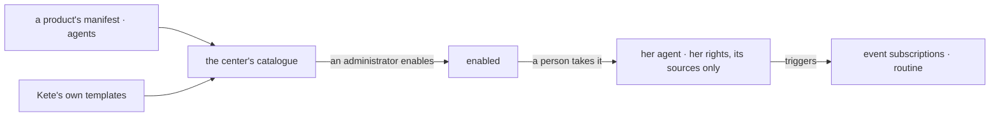

# Spec 146 — Agents receive Kete's tools, by source, and come in a catalogue

Doctrine D-062 (R5): an agent is Kete narrowed to a job description — its person's tools ∩ its job,
levels, budget, policies — and its job description **chooses its sources** of tools. ADR 0018
decides one assembly of tools, sources in the job description, the object's context, triggers on
events, and a catalogue of agents the products ship. This core spec gives the catalogue its
contract.

## Requirements

- **FR-001 — An agent template.** `agent-template.v1`: a name unique in its product, its label and
  mission in both languages, its sources (« kete », a set of Kete's own, a product), its
  permissions, skills, triggers (an event family with an object kind and a state; a routine at a
  time with what it is asked), its take-on (never, propose, alone), its highest level (never above
  « prepare »: committing is a person's), its face.
- **FR-002 — Shipped by a product.** `manifest.v1` gains `agents` (additive).

## The flow

## Proof

Contract tests: a template with its sources, triggers, level and face is valid and fits a manifest;
no source, a level that commits alone, a trigger that is neither an event nor a routine, a field
that is not the contract's are refused.

Kete Enterprise (its spec 104) assembles the tools by source, gives the object's context, keeps the
catalogue and makes an agent from a template.
