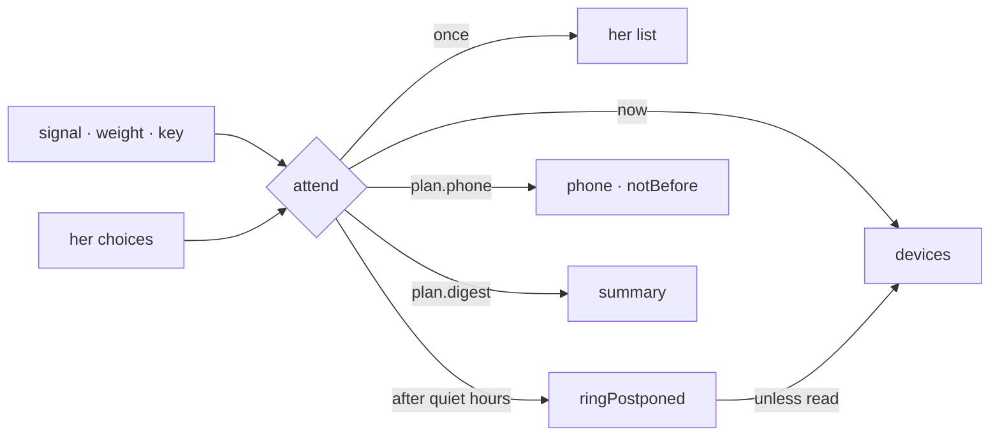

# Spec 151 — One attention model

Doctrine D-062, R14: one model decides who is told, of what, on which channel, once — « Pour moi »,
the phone, WhatsApp, Telegram, the level chosen per thread. The audit found at least six places
deciding alone: Kete Enterprise's notifications, its threads' push, its evening digest, its phone,
the relay's nudges and the agents' signals; her quiet hours (`kete.quiet_hours`) were read by none.

## Requirements

- **FR-001 — A signal and its weight.** A product raises a signal for a person: its words, where it
  opens, a weight — urgent, to act, to know — and a key.
- **FR-002 — Told once.** The same key for the same person is told once.
- **FR-003 — Her choices decide the channels.** Always her list. Urgent: her devices and her phone
  (when she chose WhatsApp or Telegram) at once, at any hour. To act: the same, but after her quiet
  hours, read at her own hour. To know: never rung; in her evening summary when she chose one.
- **FR-004 — Late, unless read.** A device held back by her quiet hours rings when they end, unless
  she read it meanwhile; a phone message waits likewise (`notBefore`).

## The flow

## Proof

`packages/notify/tests/attention.test.ts`: urgent rings at night on devices and phone; to act waits
for 07:00 in Lomé, and for 04:00 UTC in Nairobi; to know never rings and goes to the summary; the
phone only when chosen; a signal raised twice is kept once; a device held back rings past the quiet
hours, not if read meanwhile, and the worker finds the organization then no more.
`packages/notify/tests/outbox.test.ts`: a phone message given a later moment leaves only then.

## Left for later

Kete Enterprise (spec 109) moves its six paths onto `attend`, keeps her choices when she opens
« Pour moi », and sends its digest at her evening hour.
