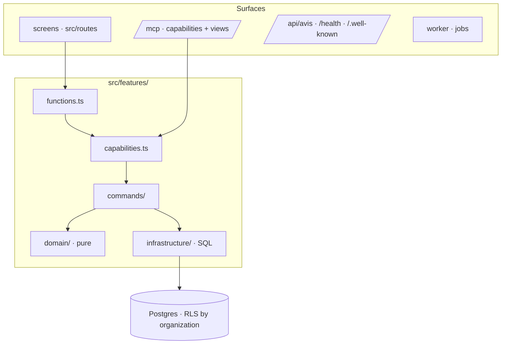
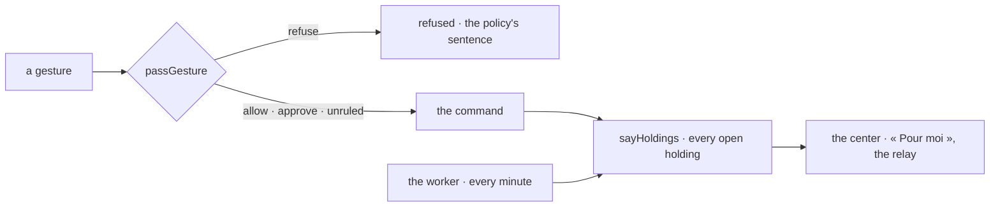

# Architecture

A modular monolith (doctrine ARCHITECTURE_APP §1): one deployment, cut into features. Every surface
— screens, MCP, API, worker — calls the same use cases.

| Concern           | Where                        | From kete-core                       |
| ----------------- | ---------------------------- | ------------------------------------ |
| Sign-in           | `platform/session.ts`        | `@kete/auth` (Compte Kete)           |
| Organization data | `platform/db.ts`             | `@kete/tenancy` (RLS)                |
| Rights            | `platform/rights.ts`         | `@kete/capabilities`, `@kete/center` |
| The center        | `platform/center.ts`         | `@kete/center` (Kete Enterprise)     |
| What it holds     | `platform/holdings.ts`       | `@kete/center` (spec 114)            |
| Policies          | `platform/policies.ts`       | `@kete/center` (spec 114)            |
| Settings          | `platform/settings.ts`       | `@kete/settings` (spec 115)          |
| Gestures, journal | `features/*/commands`        | `@kete/commands`                     |
| Agents, drafts    | `platform/registry.ts`       | `@kete/capabilities`, `@kete/drafts` |
| Copilots          | `platform/mcp.ts`            | `@kete/capabilities`, `@kete/views`  |
| E-mails, jobs     | `platform/jobs.ts`           | `@kete/notify`, `@kete/jobs`         |
| Events, manifest  | `platform/events.ts`         | `@kete/sdk`                          |
| Feedback          | `lib/shell.tsx`, `/api/avis` | `@kete/feedback`                     |
| Journal           | `/journal`, `lib/journal.ts` | `@kete/admin` (audit)                |
| Design            | `platform/app.ts`, `styles/` | `@kete/design`                       |

## The living model (kete-core spec 114)

Each feature says its things in progress as holdings (`features/*/holdings.ts`, listed in
`platform/holdings.ts`): who holds each one — a person of the center, never nobody —, on what,
waiting on whom, where it opens. The app says them all at once after every gesture of a screen
and every minute from its worker; the center keeps them in « Pour moi », relays them when their
holder is away and finishes those no longer said. Before a gesture the organization may rule
(a purchase, a signature, an assignment), `passGesture` asks the center's policies: `refuse` stops
it with the policies' sentences; `approve` takes the app's approval path; `unruled` leaves it to
the app's own rules.

## Settings (kete-core spec 115)

Kete's settings and the app's own are declared once (`platform/settings.ts`) and resolved by
layers: the Compte Kete's (the organization's, the person's), the app's kept here
(`kete_settings`), the device's cookie — the most precise wins. The page's theme and language come
from her preferences, so they follow her in every Kete app; a theme chosen in the frame is saved
there (`saveMyPreference`). The device's cookie is only their copy, rewritten from her preference,
so the page renders without a flash. No business setting is read from an environment variable.
