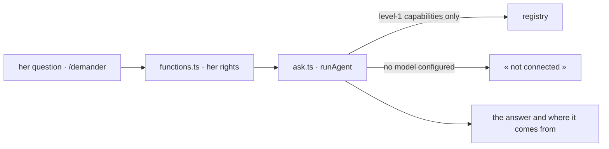

# Assistant — « Demander »

A question answered with the readings the person may open, and nothing else (kete-core specs 089
and 090). The turn runs on the chassis' agents runtime (`@kete/agents`): its only tools are her
level-1 capabilities, so it reads what she may read and changes nothing; what she asked to be
remembered is given back as context.

- `SYSTEM` holds the rules the model follows; adapt it to the trade, keep the rules.
- A gesture is never offered here: the person does it on its screen, or an agent prepares a draft
  elsewhere.
- The model is configuration (`KETE_AI_*`), never code.
