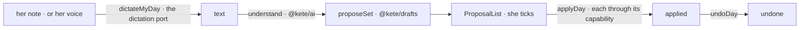

# Closure — the evening's note

She writes or says what her day was; the assistant proposes gestures **on her open tasks** — never
on what she does not have — she ticks them, applies them together, and may undo them together
(kete-core spec 104; doctrine D-051). The screen is `/soir`.

- Replace `offers` in `closure.ts` with the gestures of the app's trade, each one a capability, and
  give each reversible one its way back in `undoers`.
- The voice is offered when a transcription model is configured: `KETE_DICTATION_PROVIDER`,
  `KETE_DICTATION_MODEL`, `KETE_DICTATION_API_KEY`. The recording is not kept.
- Another person's set is not hers to decide; a level 4 gesture asks its own confirmation.
